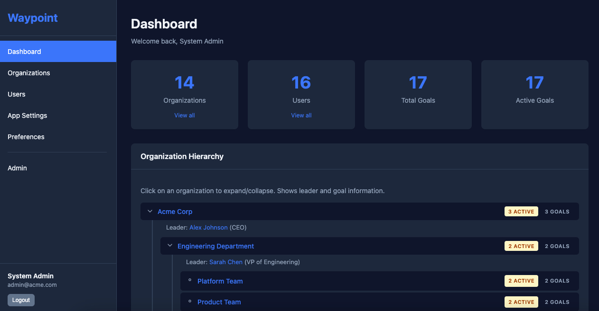
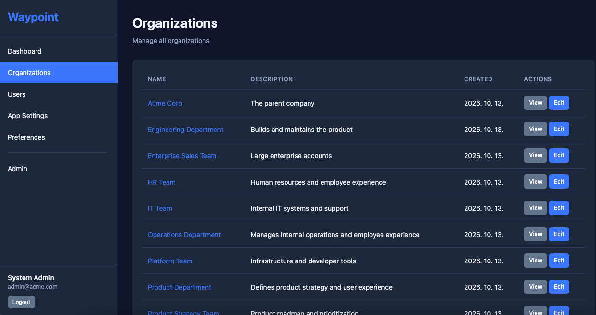
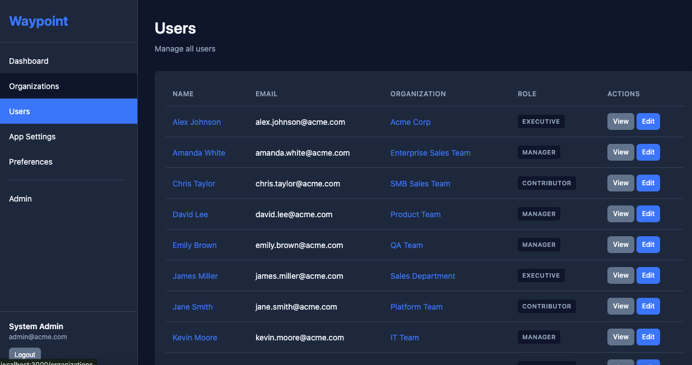
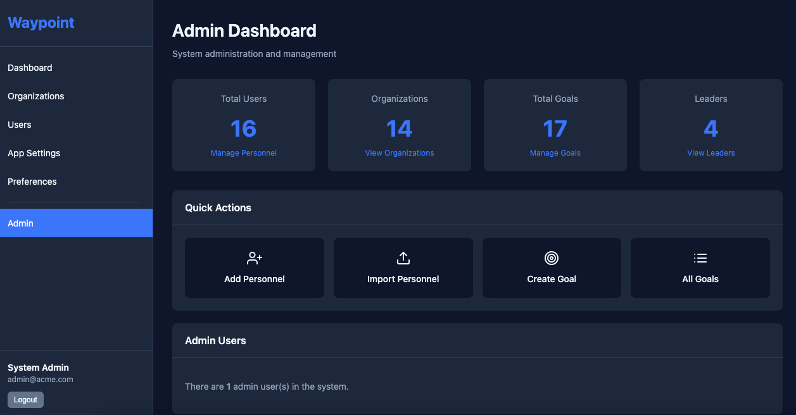
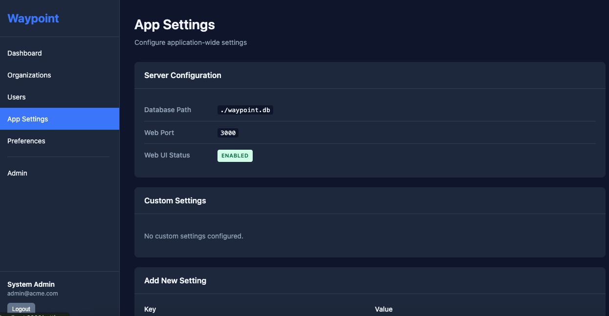
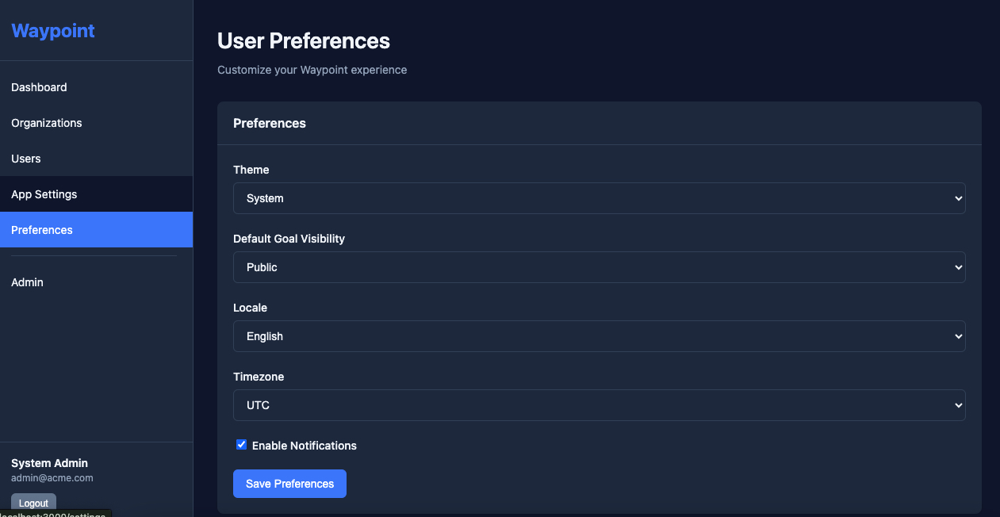

<p align="center">
  
</p>

# Waypoint

Define the organization's goals hierarchically and inject them into AI assistants through Model Context Protocol (MCP) to ensure that individual work aligns with the organization's direction.

## The Purpose Behind the Development

"I've been experimenting with 'Vibe coding' lately, and it’s fascinating how the same task can yield such different results depending on who's doing it. It made me wonder: even within the same organization, does everyone actually need different context to execute the same request? But surely, the organization's goals should be aligned, right? That train of thought led me to build this tool. I'm still testing its effectiveness, but the concept started there."

## Same Question, Different Answers

The same question gets a different, better-fitting answer depending on who asks, because each person's assistant receives their own team's goals and guidelines along with the company's.

> **"We're launching a new reporting dashboard next month. What should our plan be?"**

| Who | What the assistant steers toward | Driven by (seed data) |
|-----|----------------------------------|-----------------------|
| No context | Define scope, build an MVP, test, launch, iterate | Nothing, so the answer is generic |
| **Mike Williams**, Platform Team lead | Infrastructure as code on managed services, multi-region availability and cost estimate, monitoring and alerts before launch, backward-compatible APIs | Goal *Infrastructure as Code*; guidelines "default to managed services", "consider multi-region availability", "always consider monitoring and observability" |
| **David Lee**, Product Team lead | Feature flag with gradual rollout, web and mobile parity, a user-facing success metric, fit into the weekly release cadence | Goals *Feature Velocity*, *Code Quality*; guidelines "suggest feature flags for gradual rollouts", "consider mobile and web parity" |
| **Amanda White**, Enterprise Sales lead | Position it for multi-year strategic accounts, map it to Fortune 500 executive priorities, prepare security and procurement material before demos | Goals *Strategic Accounts*, *Expansion Revenue*; guidelines "map to executive priorities", "consider procurement and security requirements" |

These answers are illustrative: they are written by hand to show how the context steers a response, not captured from a model. The goals and guidelines are the real sample data created by `npm run seed`. Everyone also receives the company-wide guidelines, such as "always prioritize customer impact" and "maintain security and compliance in all technical decisions". To see exactly what an assistant receives, run the server as each user (`WAYPOINT_USER_ID=user-platform-lead`, `user-product-team-lead`, `user-enterprise-lead`) and read `waypoint://context/current_user`.

## Installation

Source and releases: **https://github.com/zafrem/Waypoint** (Node.js 20+ required for a source install).

### Option A: from source

```bash
git clone https://github.com/zafrem/Waypoint.git   # or download a release from /releases
cd Waypoint
npm install            # required first: the build needs the TypeScript compiler
npm run build

# Create the first admin (and your root organization) on an empty database
npm run init -- --email you@example.com --name "Your Name" --org "Your Company"

WAYPOINT_USER_ID=<admin user id printed by init> npm start
```

Open http://localhost:3000 and log in with the admin email. Add organizations, users and goals from the admin pages. `npm run init` only works on an empty database, so it cannot be used to add an admin later.

> `npm run seed` loads the **Acme Corp demo data** (including `admin@acme.com`) and **wipes the database**. Use it to try Waypoint out, never on a real instance.

### Option B: Docker

```bash
curl -O https://raw.githubusercontent.com/zafrem/Waypoint/main/docker-compose.yml
export WAYPOINT_ADMIN_EMAIL=you@example.com
export WAYPOINT_SESSION_SECRET=$(openssl rand -hex 32)
docker compose up -d
```

The image is `zafrem/waypoint` (built by the release workflow on each `v*` tag); data lives in the `waypoint-data` volume. The initial admin is created on first start from `WAYPOINT_ADMIN_EMAIL`. The container runs the web UI only. To attach an MCP client to it, run the stdio server inside the container:

```json
{
  "mcpServers": {
    "waypoint": {
      "command": "docker",
      "args": ["exec", "-i", "-e", "WAYPOINT_MCP_ENABLED=true", "-e", "WAYPOINT_WEB_ENABLED=false",
               "-e", "WAYPOINT_USER_ID=<user id>", "waypoint", "node", "dist/index.js"]
    }
  }
}
```

### Security notes

- **Login is by email only (no password).** Anyone who can reach the web UI and knows an email can sign in as that user. That is why the UI listens on `127.0.0.1` by default (`WAYPOINT_WEB_HOST`; the Docker image uses `0.0.0.0`). Only expose it behind a VPN, a trusted network or an authenticating reverse proxy.
- Set `WAYPOINT_SESSION_SECRET` to a long random value.
- Exports (`/settings/export`) contain all data; treat them as sensitive.

## Configuration

Create a `.env` file based on `.env.example`:

```bash
# User ID for the current session (required)
WAYPOINT_USER_ID=user-jane-smith

# Database file path (optional, defaults to ./waypoint.db)
WAYPOINT_DB_PATH=./waypoint.db

# First run only: create the initial admin when the database has no users
WAYPOINT_ADMIN_EMAIL=you@example.com

# Web UI host/port (defaults 127.0.0.1 / 3000), session secret, and MCP on/off
WAYPOINT_WEB_HOST=127.0.0.1
WAYPOINT_SESSION_SECRET=<long random string>
WAYPOINT_MCP_ENABLED=true
```

See `.env.example` for every variable.

## Usage

### Starting the Server

```bash
WAYPOINT_USER_ID=user-jane-smith npm start
```

### Using with Claude Desktop

Add to `~/Library/Application Support/Claude/claude_desktop_config.json`:

```json
{
  "mcpServers": {
    "waypoint": {
      "command": "node",
      "args": ["/path/to/Waypoint/dist/index.js"],
      "env": {
        "WAYPOINT_USER_ID": "user-jane-smith"
      }
    }
  }
}
```

### Using with Google Gemini

For Gemini clients that support MCP (like Gemini Developer API or compatible tools), use the standard server configuration:

```json
{
  "mcpServers": {
    "waypoint": {
      "command": "node",
      "args": ["/path/to/Waypoint/dist/index.js"],
      "env": {
        "WAYPOINT_USER_ID": "user-jane-smith"
      }
    }
  }
}
```

### Testing with MCP Inspector

```bash
WAYPOINT_USER_ID=user-jane-smith npx @modelcontextprotocol/inspector node dist/index.js
```

## Screenshots

The web UI for managing organizations, users, goals and settings (shown with the seeded sample data).

| | |
|---|---|
| <br><b>Dashboard</b><br>Totals and the expandable organization hierarchy, with each team’s leader and goal counts. | <br><b>Organizations</b><br>Every organization in the tree, with its description and quick links to view or edit. |
| <br><b>Users</b><br>All users with their organization and system role. | <br><b>Admin dashboard</b><br>Quick actions to add or import personnel and to create and manage goals. |
| <br><b>App settings</b><br>Server configuration and custom application-wide settings. | <br><b>User preferences</b><br>Theme, default goal visibility, locale, timezone and notifications. |

## MCP Resources & Tools

### Resource

| URI | Description |
|-----|-------------|
| `waypoint://context/current_user` | Returns user context with goals and AI guidelines |

### Tools

| Tool | Description |
|------|-------------|
| `get_parent_goals` | Get goals from parent organizations for strategic context |
| `search_collaborator_goals` | Search goals across accessible organizations |
| `submit_question` | Submit a question about a goal from another team |
| `semantic_search` | Search goals across the organization for a topic, limited by your role and goal visibility (requires the `vector:search` permission) |
| `get_goal_plans` | Everyone's execution plans and the gray areas for a goal you work on |
| `update_my_plan` | Write or update your own execution plan for a goal you work on |
| `raise_gray_area` | Flag something unclear in a goal or a teammate's plan |
| `resolve_gray_area` | Record how a gray area was clarified |
| `lookup_standards` | Look up standard term definitions, variable/metadata field names (e.g. `membersrl`), and common functions |

## Terminology and Coding Standards

Organizations and goals can define shared **terminology, standard variable/metadata field names, and common functions** so every team and AI assistant follows the exact same conventions:

- Enter standards as YAML in the [Fideslang](https://ethyca.github.io/fideslang/) style: a top-level key per type, each holding a list of entries with `fides_key` (the identifier), `name`, `description`, and an optional `parent_key`:
  - Supported types: `term`, `variable`, `metadata`, `function`, `document`, `ui_element`, `template`.
  - Example:
    ```yaml
    term:
      - fides_key: membersrl
        name: Member Serial
        description: Unique identifier for a customer, consisting of 8 to 16 digits.
    function:
      - fides_key: isValidMemberSrl(membersrl)
        name: Validate Member Serial
        description: Returns true if membersrl is an 8-16 digit string.
    ```
- **Inherited down the hierarchy:** Standards defined on a parent organization (such as `Acme Corp`) or parent goals automatically flow into every child team's `waypoint://context/current_user` context and can be queried via the `lookup_standards` MCP tool.

### Use as a skill (no MCP needed)

The same vocabulary can be exported as a [Claude Code skill](https://docs.claude.com/en/docs/claude-code/skills) (`SKILL.md`: a glossary plus the Fideslang YAML source), so assistants load it without the MCP server:

- Web: **Download Skill** on an organization's page (`/organizations/<id>/skill`).
- CLI: `npm run export:skill -- "<organization name or id>" [skills dir]` writes `.claude/skills/<org>-terminology/SKILL.md`.

Standards are inherited from the organization's parents plus its current goals, so a team's skill includes company-wide terms.

### Saving, loading, and sharing data

Admins can use **Settings → Save & Share Data** to download all data as one JSON file (`/settings/export`) or upload such a file to restore it (`/settings/import`). Import replaces all current data, signs everyone out, and is rejected if the file has no admin user. The CLI equivalents are `npm run export` and `npm run import`. To share only an organization's terminology, use **Export YAML** (Fideslang YAML, pasteable into another instance's organization edit page) or **Download Skill** on its page.

## Quarterly and Annual Goals

A goal can be tagged with a period, so annual and quarterly OKRs live side by side:

- **Annual** goals use a year as the period (`2026`). **Quarterly** goals use `2026-Q3`.
- A quarterly goal can optionally support an annual goal ("Supports annual goal: ..."). Leave it empty for quarterly work that does not map to an annual goal.
- Goals with no period are ongoing and always shown.
- By default the MCP context and tools only include the **current year's and current quarter's** goals (plus any annual goal a current quarterly goal supports), so past quarters do not crowd the context. `get_parent_goals` and `search_collaborator_goals` accept `include_past_periods: true` to look further back.

Set the period in the admin UI under **Goals** (create or edit); the goals list can be filtered by period.

## Execution Plans and Gray Areas

Leaders define only the **objective** (title, description, key results). The people doing the work write the **execution plans**:

- A goal has **participants**, each with a role (`driver`, `contributor` or `reviewer`). The goal owner is a driver automatically. The owner or an admin adds and removes participants on the goal page (`/goals/<id>`).
- Each participant writes **their own plan** for the goal, on the goal page or with `update_my_plan`. Nobody edits someone else's plan.
- Anyone working on the goal can flag a **gray area**: something unclear in the goal or in a teammate's plan. Anyone on the goal can mark it resolved with a note on how it was clarified, so ambiguities are cleared up together rather than guessed at.
- **Plans are visible only to the people working on that goal** (plus admins). To everyone else the goal shows just the objective, and the MCP tools answer "not found" exactly as they would for a goal that does not exist. For goals you work on, the `current_user` context includes your plan, your teammates' plans and the open gray areas.

## Disabling MCP Access

Admins can switch off the MCP side (the `waypoint://context/current_user` resource, the `ask_with_context` prompt and all tools) for a single user or for a whole organization. Web login is not affected.

- Tick **Disable MCP access** on a user's or an organization's edit page (admins only).
- Disabling an organization also disables every user in it and in all of its sub-organizations. Disabling Engineering Department also covers the Platform, Product and QA teams.
- For a disabled user the MCP server simply does nothing: it lists no resource, no prompt and no tools, and any direct call fails as if it didn't exist. No notice or explanation is shown, and `ask_with_context` passes the question through without any context.
- The check runs on every request, so changing the flag takes effect without restarting the server.
- The user and organization lists show an **MCP off** badge, or **MCP off (inherited)** when it comes from a parent organization.
- The flag is included in `npm run export` / `npm run import`. Existing databases get the new columns automatically on the next start.

## Available Scripts

| Script | Description |
|--------|-------------|
| `npm install` | Install dependencies (run this first, and again whenever `package.json` changes) |
| `npm run build` | Compile TypeScript to JavaScript |
| `npm run start` | Start the MCP server |
| `npm run dev` | Build and start in one command |
| `npm run seed` | Populate database with example data |

## Sample Users

After running `npm run seed`, the following users are available:

| User ID | Name | Organization |
|---------|------|--------------|
| `user-jane-smith` | Jane Smith | Platform Team |
| `user-ceo` | Alex Johnson | Acme Corp |
| `user-vp-engineering` | Sarah Chen | Engineering Department |
| `user-platform-lead` | Mike Williams | Platform Team |
| `user-product-team-lead` | David Lee | Product Team |
| `user-enterprise-lead` | Amanda White | Enterprise Sales Team |

## Documentation

- [Architecture](docs/architecture/README.md)
- [Example Hierarchy](docs/architecture/example-hierarchy.md)

